# Schedule — Real-time Flood Risk Alerter

แผนแบ่งงาน 2 คน (Mini Project, 1 วัน) — Java CLI, OOP, Stateless, No Database

- **ระยะเวลา:** 1 วัน (09:00 – 18:00)
- **ทีม:** **คน A** (Data Layer) และ **คน B** (Logic + CLI)
- **หลักการ:** ผูกงานกันที่ interface `WeatherProvider` ตัวเดียว (ดู [CONTRACT.md](CONTRACT.md)) — **B เริ่มกับ Mock ได้ทันที ไม่ต้องรอ A**
- **Git:** ดู [GIT_FLOW.md](GIT_FLOW.md)

---

## 1. การแบ่งงาน

| | คน A: Data Layer | คน B: Logic + CLI |
|---|---|---|
| **ไฟล์** | `TmdWeatherProvider`, `MockWeatherProvider`, `WeatherException` | `RiskAnalyzer`, `RiskResult`, `Main` (CLI), `AlertPrinter` |
| **งานหลัก** | สมัคร/ขอ token TMD, ศึกษา endpoint, เรียก API, แปลง JSON เป็น `WeatherData` | เขียนกฎประเมินความเสี่ยง, อ่าน args (เช่น `java -jar app.jar Bangkok`), พิมพ์ผลแบบอ่านง่าย (สี/ไอคอนตามระดับ) |
| **ช่วงเช้า** | ทำ Mock ก่อน (15 นาที) เพื่อให้ B ใช้งานได้ทัน แล้วค่อยต่อ API จริง | ทำกับ Mock ได้เลย ไม่ต้องรอ A |
| **ช่วงบ่าย** | จัดการ error (timeout, token ผิด, ไม่พบพื้นที่) | เขียนเทสต์ `RiskAnalyzer` 4–5 เคส, จัดการ args ผิดรูปแบบ |
| **ร่วมกัน** | ต่อระบบ end-to-end, ทดสอบกับ API จริง, README, ซ้อมเดโม | |

---

## 2. ตารางเวลา

| เวลา | คน A — Data Layer | คน B — Logic + CLI | Gate |
|------|-------------------|--------------------|------|
| **09:00 – 09:30** | **ร่วมกัน:** อ่านโจทย์, ยืนยัน CONTRACT, ตั้ง Maven project + `.gitignore`, สร้าง branch `develop` | เหมือนกัน | ✅ 1: CONTRACT ยืนยัน, `mvn compile` ผ่าน |
| **09:30 – 09:45** | `RiskLevel`, `WeatherData`, `WeatherProvider`, `WeatherException` + **`MockWeatherProvider`** → PR เข้า `develop` | อ่าน CONTRACT 3.3, เตรียม skeleton `RiskAnalyzer` / `RiskResult` | ✅ 2: B ดึง Mock ไปใช้ได้ |
| **09:45 – 12:30** | สมัคร/ขอ token TMD, ศึกษา endpoint, `TmdWeatherProvider` (เรียก API + parse JSON) กรณีปกติ | `RiskAnalyzer` (กฎ 3 ระดับ), `RiskResult`, `AlertPrinter`, `Main` อ่าน `<location>` และ `--mock` | PR แรกของแต่ละคน |
| **12:30 – 13:30** | พักเที่ยง + review PR กันและกัน + sync 5 นาที | เหมือนกัน | PR merge เข้า `develop` |
| **13:30 – 15:30** | จัดการ error: timeout, token ผิด, ไม่พบพื้นที่ → `WeatherException` | เทสต์ `RiskAnalyzer` 4–5 เคส, จัดการ args ผิดรูปแบบ + exit code | ✅ 3: `mvn test` ผ่าน |
| **15:30 – 16:45** | **ร่วมกัน:** ต่อ `Main` กับ `TmdWeatherProvider`, ทดสอบกับ API จริงหลายสถานที่ | เหมือนกัน | ✅ 4: รันจริงได้ทั้ง 3 ระดับ (ใช้ Mock ช่วยครบ SAFE/WARNING/DANGER) |
| **16:45 – 17:30** | README ส่วน Setup (token, build) + แก้บั๊ก | README ส่วน Usage + ปรับ output + แก้บั๊ก | feature freeze 17:30 |
| **17:30 – 18:00** | **ร่วมกัน:** PR `develop` → `main`, ซ้อมเดโม (ทั้ง API จริงและ `--mock`) | เหมือนกัน | ✅ 5: `main` พร้อมส่ง |

```mermaid
gantt
    title Flood Risk Alerter - 1 Day Plan
    dateFormat HH:mm
    axisFormat %H:%M
    section ทั้งคู่
    Kick-off / CONTRACT / ตั้ง repo        :k1, 09:00, 30m
    ต่อระบบ + ทดสอบ API จริง               :i1, 15:30, 75m
    PR to main + ซ้อมเดโม                  :i2, 17:30, 30m
    section คน A
    Model + Provider interface + Mock      :a1, 09:30, 15m
    TmdWeatherProvider                     :a2, 09:45, 165m
    จัดการ error                           :a3, 13:30, 120m
    README Setup                           :a4, 16:45, 45m
    section คน B
    Skeleton RiskAnalyzer                  :b1, 09:30, 15m
    RiskAnalyzer + AlertPrinter + Main     :b2, 09:45, 165m
    เทสต์ + args ผิดรูปแบบ                 :b3, 13:30, 120m
    README Usage                           :b4, 16:45, 45m
```

---

## 3. Gate / Definition of Done

| Gate | เวลา | เงื่อนไขผ่าน |
|------|------|--------------|
| 1 | 09:30 | CONTRACT ยืนยัน, Maven project build ผ่าน |
| 2 | 09:45 | `develop` มี `WeatherProvider` + `MockWeatherProvider` ให้ B ใช้ |
| 3 | 15:30 | โค้ดทั้งสองฝั่ง merge แล้ว, `mvn test` ผ่าน |
| 4 | 16:45 | รัน CLI ได้จริง ผลตรงกับเกณฑ์ |
| 5 | 18:00 | `main` build ผ่าน, README ครบ, ซ้อมเดโมแล้ว |

**Done ต่อ 1 งาน:** compile ผ่าน + อีกคน review แล้ว + merge เข้า `develop`

---

## 4. ความเสี่ยงและแผนสำรอง

| ความเสี่ยง | แผนสำรอง |
|------------|----------|
| ยังไม่ได้ TMD token / token ใช้ไม่ได้ | ใช้ `--mock` ต่อไป เดโมได้ทั้ง 3 ระดับ |
| TMD ไม่มี field "โอกาสฝนตก %" ตรงๆ | A แจ้ง B ตั้งแต่ช่วงเช้า → ปรับเกณฑ์ใน CONTRACT 3.3 (เช่น map จากสภาพอากาศ) หรือใช้ค่าที่ใกล้เคียงที่สุด |
| API ล่มตอนเดโม | สลับเป็น `--mock` |
| Merge conflict | แต่ละคนแตะเฉพาะไฟล์ของตัวเอง; ไฟล์ร่วม (`pom.xml`, README) แก้ใน PR สั้นๆ |
| เวลาไม่พอ | ตัดความสวยงามของ output ก่อน; ห้ามตัดเทสต์ `RiskAnalyzer` |
